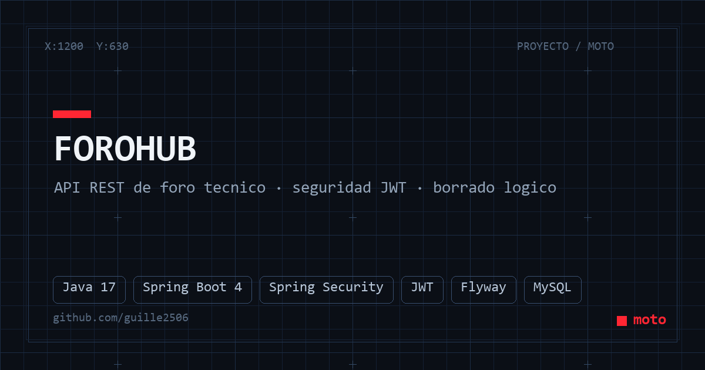

<div align="center">
  
</div>

# ForoHub — API REST de foro técnico 💬

Backend REST **stateless** que simula un foro profesional de discusión: tópicos, respuestas, cursos y usuarios, con **autenticación JWT**, **integridad de datos** y **borrado lógico** para mantener el historial.

Proyecto del desafío *Foro Hub* (Alura One).

---

## 🚀 Clonar y correrlo

### Requisitos
- Java JDK **17** + Maven (el wrapper `mvnw` viene incluido)
- **MySQL** corriendo en `localhost:3306`
- Crear la base `forohub_db` (las tablas las genera **Flyway** solo al arrancar)

```bash
git clone https://github.com/guille2506/ForoChallenge.git
cd ForoChallenge
```

### Variables de entorno

| Variable      | Para qué                                  |
|---------------|-------------------------------------------|
| `DB_USERNAME` | usuario de MySQL (ej: `root`)             |
| `DB_PASSWORD` | contraseña de MySQL                       |
| `JWT_SECRET`  | frase secreta para firmar los tokens      |

⚠️ No olvides configurarlas — sin ellas la app no arranca.

### Arrancar

**Windows (PowerShell):**

```powershell
$env:DB_USERNAME = "root"
$env:DB_PASSWORD = "tu_password"
$env:JWT_SECRET  = "una-frase-secreta-larga"
.\mvnw.cmd spring-boot:run
```

**macOS / Linux:**

```bash
export DB_USERNAME=root
export DB_PASSWORD=tu_password
export JWT_SECRET="una-frase-secreta-larga"
./mvnw spring-boot:run
```

La API queda en **`http://localhost:8080`**.

---

## 🔌 Endpoints principales

| Método                | Ruta                      | Qué hace                                          |
|-----------------------|---------------------------|---------------------------------------------------|
| `POST /login`         | email + contraseña        | Devuelve el **token JWT** (el resto pide Bearer)  |
| `GET/POST /topicos`   | + `PUT/DELETE /{id}`      | CRUD de tópicos (autor + curso)                   |
| `PUT /respuestas/{id}/solucion` | marca solución  | El tópico pasa a estado **SOLUCIONADO** automático|
| `GET/POST /respuestas`| + `PUT/DELETE /{id}`      | CRUD de respuestas                                |
| `GET/POST /cursos`    | + `PUT/DELETE /{id}`      | Catálogo de cursos                                |
| `GET/POST /perfiles`  |                           | Perfiles (roles)                                  |
| `GET /usuarios/{id}`  | + `DELETE`                | Usuarios registrados                              |

Todo el CRUD de tópicos usa **borrado lógico**: nada se elimina de la base, se marca inactivo para conservar el historial y estadísticas.

---

## 🧱 Stack

| Capa        | Tecnología                                            |
|-------------|-------------------------------------------------------|
| Lenguaje    | Java 17                                               |
| Framework   | Spring Boot 4 (Web, Data JPA, Security)               |
| Seguridad   | Spring Security + JWT                                 |
| Migraciones | Flyway                                                |
| Base        | MySQL                                                 |

---

<p align="center">
  <sub><b>moto</b> · hecho con cariño — <a href="https://nuevoportfolio.vercel.app/works/javaProyectos/index.html">portfolio</a></sub>
</p>
